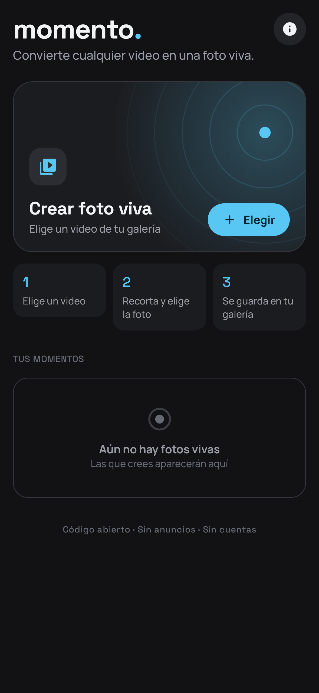
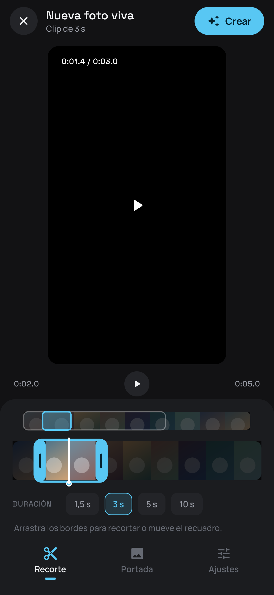
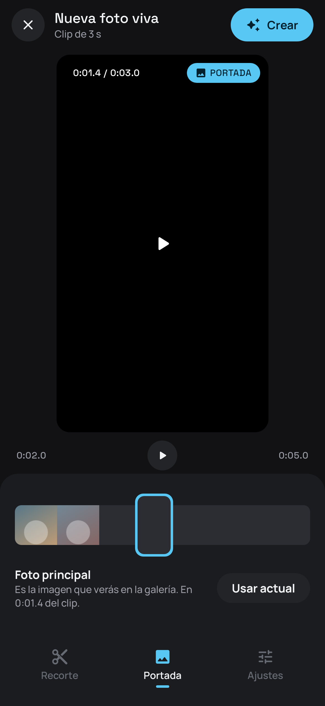

<p align="center">
  
  
  
</p>

# Momento

**Convierte cualquier video en una foto viva.**

Momento es una app para Android, libre y de código abierto. Toma un video normal, te deja recortar la parte que quieres y elegir la foto principal, y lo guarda como **foto en movimiento** (Motion Photo). Son las mismas "fotos vivas" que crean los Pixel y los Samsung Galaxy, parecidas a las Live Photos del iPhone.

- 🎞️ **Editor de video**: recorta con asas, mueve el recuadro y usa duraciones rápidas (1,5 s · 3 s · 5 s · 10 s)
- 🖼️ **Foto de portada**: elige el fotograma exacto que se ve en la galería
- 🔊 Con o sin sonido · calidad 720p / 1080p / original
- 📱 **Compatible con Google Fotos y la Galería de Samsung**
- 🔒 **Sin anuncios, sin cuentas, sin internet.** Todo se procesa en tu teléfono
- 📤 Puedes compartir un video desde la galería directamente a Momento

## Cómo funciona

El archivo resultante es un `.jpg` normal que lleva el video pegado al final, con dos tipos de metadatos para que lo reconozca cualquier galería:

| Galería | Qué lee |
|---|---|
| Google Fotos / Galería de Google | XMP `GCamera:MotionPhoto` v1 + `Container:Directory` (y los campos `MicroVideo` antiguos) |
| Galería Samsung | Bloque `MotionPhoto_Data` + tráiler `SEFH/SEFT` |

```
[ JPEG + XMP ][ 00 00 30 0A | 16 | "MotionPhoto_Data" ][ MP4 H.264/AAC ][ SEFH … SEFT ]
```

Las fotos se guardan en **Imágenes › Momento** con nombre `MVIMG_…`, porque algunas galerías exigen ese prefijo.

## Permisos

| Android | Permisos |
|---|---|
| 10 o superior | **Ninguno**. El video se elige con el selector del sistema y la foto se guarda con MediaStore |
| 8 – 9 | Almacenamiento (solo para guardar en la galería) |

La app **no tiene permiso de internet**.

## Compilar

Requisitos: JDK 17 o superior y el Android SDK (API 36).

```bash
./gradlew assembleDebug          # APK de prueba
./gradlew testDebugUnitTest      # tests + capturas de pantalla
./gradlew assembleRelease        # APK firmada (requiere keystore.properties)
```

Para la versión firmada, crea `keystore.properties` en la raíz (**no se sube al repo**):

```properties
storeFile=momento-release.jks
storePassword=****
keyAlias=momento
keyPassword=****
```

### GitHub Actions

El workflow `.github/workflows/build.yml` compila en cada push. Para que firme y publique la APK al crear un tag `v1.0.0`, agrega estos *Secrets* al repositorio:

- `KEYSTORE_B64`: el `.jks` codificado en base64 (`base64 -w0 momento-release.jks`)
- `KEYSTORE_PASSWORD`: la contraseña

## Tecnología

Kotlin · Jetpack Compose · Media3 (ExoPlayer + Transformer) · minSdk 26 · targetSdk 36

## Licencia

[GNU GPL v3.0](LICENSE). Puedes usar, estudiar, modificar y redistribuir Momento libremente. Cualquier versión modificada que se distribuya también debe ser libre y publicar su código fuente.

Tipografías: Space Grotesk y Manrope, bajo la SIL Open Font License.
